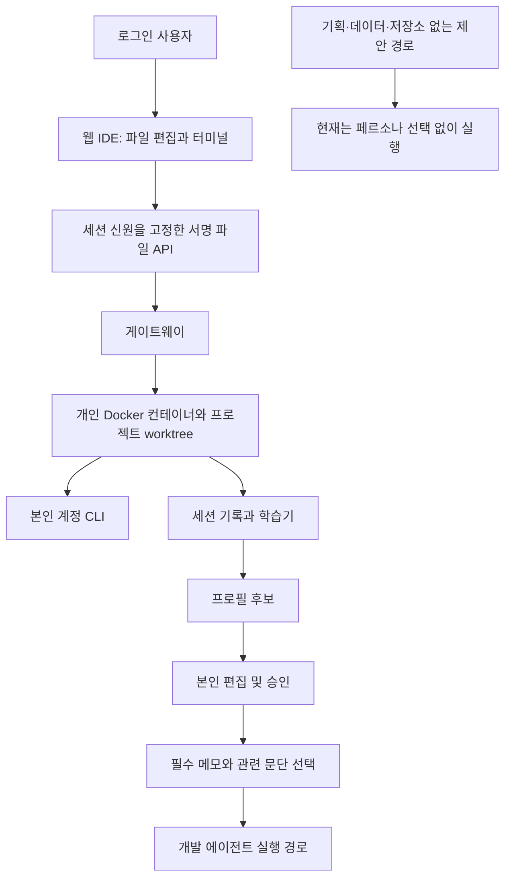

# NewPlay 개인 작업대·페르소나 교차 검증 — 2026-09-22

**판정: 현재 변경 ZIP은 운영 배포·최종 인수에 사용하기 전에 결함 수정과 재검증이 필요합니다.**

이전 기능 시험은 통과했지만, 별도로 만든 반례 시험에서 제품 변경 결함 5건과 검증 도구 결함 1건을 재현했습니다. 기존 실행 구조의 페르소나 적용 누락 1건도 확인했습니다. 이는 운영 서버에서 사고가 발생했다는 뜻이 아니라, 전달 후보 소스에서 결함을 재현했다는 뜻입니다.

제품 코드, 기준본, 전달 ZIP은 수정하지 않았습니다. 이번에 만든 파일은 `E:\AI\qa\newplay-crosscheck-20260922` 아래의 감사 스크립트·결과·보고서입니다. 이전 로컬 QA 실행 장치가 생성하는 임시 쿠키·작업 폴더·런타임 로그는 재생성됐습니다. 실제 계정·운영 DB를 사용하지 않았습니다.

## 대상과 근거

- 변경 ZIP: `E:\AI\scripts\newplay\handoff\newplay-workbench-persona-20260922-review.zip`
- 크기: 460,252 bytes.
- SHA-256: `06c1c15948f9d1df2737437563201eb1570d84f1174741e73e0b8509bdc1cec1`
- 검사 소스: `E:\AI\qa\newplay-workbench-persona-20260922\deploy`.
- 기준본: `E:\AI\qa\newplay-ubuntu-migration-20260918\handoff\deploy`.
- 방법: 변경 코드의 호출 경로 대조 → 별도 반례 작성 → Linux 임시 Git·실제 임시 MongoDB·실제 Chromium으로 재현 → ZIP 안 파일과 검사 소스·패치 대조.
- 아래 코드 위치는 검사 소스 기준입니다. `qa-fixture.cjs`, `run_checks.py`는 검사 소스의 상위 QA 폴더 기준입니다.

## 실제 구성과 효과

자체 IDE의 파일 편집·터미널과 승인 문서 기반 대리 실행은 구현되어 있습니다. 그러나 아래 결함과 경로 누락 때문에 모든 작업이 그 사람의 지침을 따른다고 판단할 수 없습니다. IDE 자체가 모델 성능을 높이는 구조도 아니며, 직접 CLI와 같은 품질을 확인한 비교 시험은 없습니다.

분량 제한은 **페르소나 최초 삽입 부분의 UTF-8 바이트 예산**입니다. 전체 대화·코드·도구 출력·추가 원문 읽기의 실제 토큰이나 요금을 제한하지 않습니다. 승인 원문 파일을 다시 읽으면 사용량이 추가됩니다.

## 재현한 결함

| 번호 | 중요도 | 구분 | 현상 |
|---|---|---|---|
| X-01 | 보통 | 제품 변경 | Git 비교가 파일 읽기 제한을 우회함 |
| X-02 | 높음 | 제품 변경 | 최초 저장과 학습이 겹치면 프로필이 중복 생성되어 승인 메모를 읽지 못함 |
| X-03 | 보통 | 제품 변경 | 페르소나 저장 중 추가 입력이 응답 도착 후 사라짐 |
| X-04 | 보통 | 제품 변경 | 역할만 저장하면 예산 초과 상태를 정상 저장으로 허용함 |
| X-05 | 낮음 | 제품 변경 | 새 폴더 안의 미추적 파일이 Git 변경 목록에서 누락됨 |
| X-06 | 보통 | 검증 도구 | 제공된 통합 시험 실행기가 현재 Windows/WSL 환경에서 시작부터 실패함 |
| X-07 | 보통 | 기존 구조의 기능 누락 | 기획·데이터·저장소 없는 개발 제안 경로에서는 지정 페르소나를 사용하지 않음 |

### X-01: Git 비교의 읽기 제한 우회

- 위치: `gateway/ide-files.py:48`, `:150`; 웹 허용 경로 `src/web/src/app/api/workbench/files/route.ts:16`.
- 재현 A: 추적된 `src/.env` 내용을 변경한 뒤 `read("src/.env")`는 403. `diff("src")`는 하위 `.env` 변경 내용을 반환했습니다.
- 재현 B: 추적된 일반 파일을 작업 폴더 밖의 합성 파일에 대한 하드링크로 교체. `read`는 403이지만 `diff`는 외부 파일의 합성 마커를 반환했습니다.
- 원인: `diff` 분기는 마지막 경로를 일반 파일로 검증하지 않고 Git에 경로를 전달합니다. 디렉터리 경로는 하위 파일까지 비교하고, 하드링크는 내용을 읽습니다.
- 범위: 인증된 사용자에게 노출된 파일 API의 보호 규칙 위반입니다. 익명 접근이나 다른 사람 계정 탈취를 재현한 것은 아닙니다. 기존 개인 터미널 자체의 권한은 더 넓습니다.
- 최소 수정 방향: 비교 대상과 출력에도 동일한 파일 정책 적용. 삭제 파일 비교를 유지하면서 디렉터리·하드링크·금지 경로 우회 차단.
- 근거: `probe_files.py`, `files-results.json`의 두 diff 마커와 read 403.

### X-02: 프로필 중복 생성과 승인 메모 누락

- 위치: `src/web/src/app/api/profiles/route.ts:53`, `:74`; `src/watcher/profiles.py:159`, `:196`.
- 재현: API의 최초 `findOne`이 없음을 읽은 직후, 실제 Python `update_from_session`을 실행해 학습 프로필을 생성했습니다. 이어 실제 API의 승인 저장을 진행했습니다.
- 결과: HTTP 200, 동일 email·project에 문서 **2개**. 학습기는 ObjectId 문서를, API는 `profile:<email>:<project>` 문서를 생성했습니다. 실제 Python `profiles.get`은 승인 메모가 빈 첫 문서를 읽었습니다.
- 시험 DB에는 MongoDB 기본 `_id` 인덱스만 있었습니다. 전달 소스에서 email·project 고유 인덱스를 보장하는 생성 코드는 찾지 못했습니다. **운영 DB에 별도로 고유 인덱스가 있는지는 이번에 확인하지 못했습니다.** 그 인덱스가 있다면 중복 삽입은 거절됩니다.
- 최소 수정 방향: 모든 생성 경로의 식별 기준 통일, email·project 유일성 보장, 최초 생성 경쟁 시 재조회 또는 충돌 응답. 이미 존재하는 중복 데이터는 덮어쓰지 않고 별도 확인.
- 근거: `probe_profiles.cjs`, `profiles-results.json`의 실제 문서·인덱스·Python 조회 결과. 인증만 합성 사용자로 대체했고 MongoDB 및 두 저장 구현은 실제 코드를 사용했습니다.

### X-03: 저장 중 추가한 문서 내용 손실

- 위치: `src/web/src/components/ProfilesView.tsx:23`, `:28`, `:45`, `:90`.
- 재현: Chromium에서 초안 저장 요청을 잠시 보류 → 입력 가능한 문서에 두 번째 줄 추가 → 보류했던 요청 계속 진행.
- 결과: 저장 버전이 올라가면서 카드가 다시 생성되어 두 번째 줄이 사라졌습니다. DB와 화면 모두 첫 번째 줄만 남았고 추가 입력에 대한 경고는 없었습니다.
- 원인: 저장 중에도 입력을 허용하지만, 성공 후 버전을 React key로 사용한 카드가 재생성되어 요청 이후 입력을 버립니다.
- 최소 수정 방향: 저장 중 입력을 잠그거나, 저장 요청 당시 내용과 현재 내용을 구분해 새 입력을 보존.
- 근거: `probe_browser.py`, `browser-results.json`, `persona-lost-edit.png`. 실제 production Next 빌드·API·MongoDB·Chromium 사용.

### X-04: 역할 저장을 통한 예산 검증 누락

- 위치: `src/web/src/app/api/profiles/route.ts:65`; `src/web/src/lib/persona-context.js:27`; `src/watcher/hermes_executor.py:642`.
- 재현: 필수 컨텍스트가 예산 2,000에 정확히 맞는 프로필에서 `role_label`만 추가 저장.
- 결과: API는 HTTP 200을 반환했지만 같은 선택기는 즉시 예산 초과 오류를 반환했습니다. 실제 대리 실행기도 이 오류를 받으면 실행을 중단하는 경로입니다.
- 원인: 예산 검사는 계산하지만 거절 조건을 메모·예산 변경 또는 승인에만 적용합니다. 역할도 필수 컨텍스트 길이를 늘립니다.
- 최소 수정 방향: 필수 컨텍스트에 영향을 주는 모든 변경을 같은 예산 규칙으로 검증.
- 근거: `probe_profiles.cjs`, `profiles-results.json`의 `role_budget`. 실제 모델 호출 없이 저장과 선택 결과를 재현했습니다.

### X-05: 새 폴더의 파일이 변경 목록에서 사라짐

- 위치: `gateway/ide-files.py:85`, `:98`.
- 재현: 추적되지 않은 `newdir/new.py` 생성 후 `changes` 요청.
- 결과: Git은 `?? newdir/`를 반환하지만 API 결과에는 이 폴더와 파일이 모두 없었습니다. 다른 파일도 변경되지 않았다면 변경 목록이 빈 것으로 보일 수 있습니다.
- 원인: `--untracked-files=normal`의 디렉터리 요약 이름이 끝의 `/` 때문에 일반 파일 경로 검사에서 제외됩니다.
- 최소 수정 방향: 새 파일을 개별 조회하거나 미추적 디렉터리 표시를 별도로 처리.
- 근거: `probe_files.py`, `files-results.json`의 실제 Git 상태와 API 결과.

### X-06: 전달된 통합 시험 실행기 재실행 실패

- 위치: `run_checks.py:8`, `qa-fixture.cjs:13`.
- 재현: 현재 Windows 작업 폴더에서 원본 `run_checks.py`와 `qa-fixture.cjs`를 실행.
- 결과: `wslpath: E:AIqanewplay-workbench-persona-20260922`, 종료 코드 1. Windows 경로의 역슬래시가 WSL 전달 과정에서 사라졌습니다.
- 원본 통합 실행기는 하위 시험 시작 전 종료됩니다. ZIP 속 두 스크립트가 현재 파일과 동일함도 대조했습니다. 따라서 이전 통과 로그만으로 이 전달본을 그대로 재실행할 수 있다고 판단할 수 없습니다.
- 이번 브라우저 재현은 **감사 전용 메모리 사본**에서 WSL 경로 인수를 `/` 표기로 바꿔 실행했습니다. 제품과 원본 QA 스크립트는 고치지 않았습니다.
- 최소 수정 방향: Windows/WSL 경로 전달을 수정하고, 최종 ZIP에 들어갈 바로 그 파일로 통합 시험을 다시 실행. QA 폴더에 전체 기준 소스·의존성이 필요한 준비 절차도 명시.
- 근거: `original_runner.log`, `start_fixture.cjs`, `artifact-results.json`.

### X-07: 일부 대리 업무에는 페르소나가 적용되지 않음

- 위치: `src/watcher/hermes_executor.py:805`, `:813`, `:826`.
- 재현: `mode=proxy`, `act_as=owner@example.test`인 기획·데이터·저장소 없는 개발 작업을 실제 `_run_work`에 각각 전달. 모델·검색·외부 저장만 시험 대체 장치 사용.
- 결과: 세 경로 모두 `profiles.get` 호출 0회, 전달 프롬프트의 필수 메모 없음. AI 호출 직전까지 확인한 뒤 합성 실패로 종료했습니다.
- 해석: 기존 제안 경로가 유지된 데 따른 기능 누락입니다. 이 변경이 새로 유발한 회귀와 구분합니다. 해당 사용자의 이름을 결과에 실제로 붙였다는 주장도 아닙니다. **일반 실행으로 처리하면서 지정 페르소나를 사용하지 않는 것이 확인된 문제입니다.**
- 최소 수정 방향: 지원하지 않는 경로에서 대리 요청을 명시적으로 거절·안내하거나, 승인 문서 적용을 해당 경로까지 연결. 전체 실행기 재설계는 필요하지 않습니다.
- 근거: `probe_execution.py`, `execution-results.json`.

## 검색 실효성에서 추가로 확인한 한계

`## 로그인` 다음 빈 줄에 `만료 시간을 반드시 검사한다.`를 쓰고 로그인 업무를 미리보기하면, 제목만 선택되고 실제 규칙 문장은 빠집니다. 선택기가 제목과 본문을 서로 독립 문단으로 보기 때문입니다. 예산 부족도 아니었습니다. 근거는 `profiles-results.json`의 `heading_retrieval`, `persona-context.js:16`, `:44`입니다.

이는 앞서 고지한 키워드 검색 한계에 해당하므로 위 결함 수에 추가하지 않았습니다. 다만 화면이 권하는 ‘제목과 빈 줄’ 작성 방식에서도 발생하므로, 사람의 작업 방식을 재현하는 실효성 검증에는 반드시 포함해야 합니다. 원문 파일로 보완할 가능성은 있지만 실제 모델이 필요한 규칙을 찾아 읽는지는 측정하지 않았습니다.

## 정상 확인과 미확인 구분

| 항목 | 이번 결과 |
|---|---|
| 기존 선택기·서명 시험 | 재실행 통과 |
| 기존 웹 route 시험 | 재실행 통과; 기존 합성 DB 시험은 X-02 경쟁 조건을 검사하지 않음 |
| 기존 gateway 시험 | 재실행 통과; 실제 HTTP 처리기·Linux 도우미, Docker는 대체 장치 |
| 기존 Linux 파일 시험 | 8개 재실행 통과; 제한 우회 diff와 새 하위 폴더 반례는 기존 시험에 없음 |
| 기존 Python 실행기 시험 | 5개 재실행 통과; 비개발 경로는 기존 시험 대상 아님 |
| 통합 시험 실행기 | X-06으로 시작 실패 |
| 브라우저 추가 시험 | X-03 손실 재현. 이전 6개 브라우저 시나리오 전체를 다시 수행한 것은 아님 |
| ZIP 파일과 실제 검사 소스 | 변경 24개 모두 바이트·SHA 일치, CRC 정상 |
| 패치 | 격리된 기준 사본에서 3개 패치 check 및 실제 적용 성공, 적용 결과 내용 일치 |
| 제품 재빌드 | 이번에는 수행하지 않음. 소스 변경 없음; 이전 두 빌드 로그만 존재 |
| 운영 Ubuntu·실제 Docker·공개 HTTPS/WSS·물리 재부팅 | 이번 원격 실측 없음 |
| 실제 개인 계정 AI 실행·직접 CLI와 품질 비교 | 미실시. 본인 계정으로 별도 수행 필요 |
| 기존 의존성 보안 권고 | 이전 보고서에 12개 패키지 항목. 이번에 최신 조회나 악용 재현은 하지 않음 |

`baseline-results.json`의 0은 기존 시험 통과입니다. 반면 `probe_*.py/cjs`의 종료 코드 0은 **결함 재현에 성공했다는 뜻**이며 제품 정상 판정이 아닙니다. 이를 통과 항목 수에 섞지 않았습니다.

## 다음 작업의 정확한 범위

1. X-01~X-06만 좁게 수정하고 해당 반례를 회귀 시험으로 전환.
2. X-07은 지원 범위를 사용자에게 분명히 표시하거나 같은 승인·선택 처리를 연결.
3. 최종 소스에서 시험과 패키징을 다시 수행. 현재 ZIP의 검수 완료 문구를 운영 인수 승인으로 사용하지 않기.
4. 그다음 운영 접속을 복구해 실제 Docker에서 새 파일 API·터미널·세션 학습·대리 실행을 실측.
5. 팀원이 자기 계정을 연결해 실제 업무를 완주. 같은 모델·설정·도구·저장소·과제를 맞춘 직접 CLI 비교 없이는 품질 동등 판정을 하지 않기.

이번 감사는 수정 없이 종료합니다. 원래 약 7GB 운영 인수 ZIP의 전체 내용이나 최초 과거 감사 40개 항목을 이번에 전부 다시 검증한 것은 아닙니다. 검사 대상과 결과를 최신 IDE·페르소나 변경본으로 한정합니다.

정리 확인: 시험용 웹·게이트웨이·MongoDB를 종료한 뒤 13010/13011/13012/27999 포트의 리스너가 없고 WSL 유지용 sleep 프로세스가 없는 것을 확인했습니다. 종료 후 변경 ZIP 해시도 위 값과 동일했습니다.
